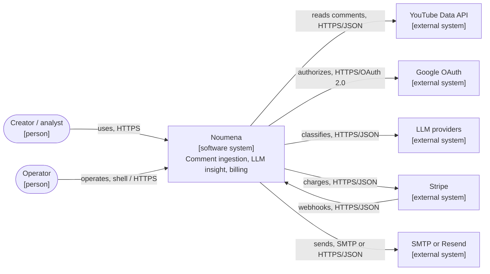
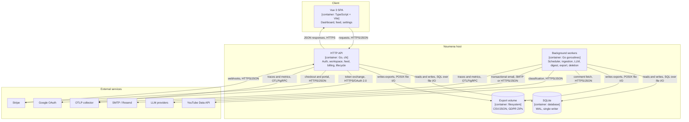
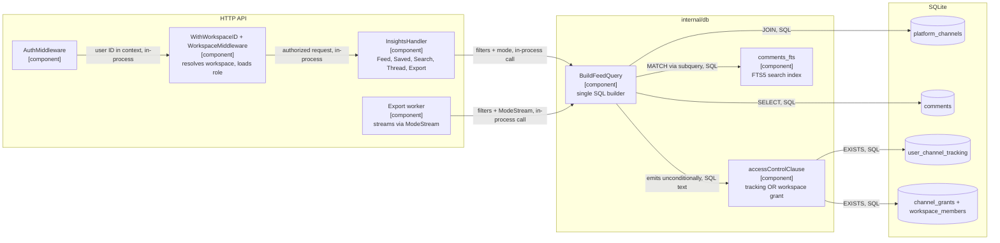

# Architecture

This page gives the C4 container view and one component zoom. Read
[design.md](design.md) for the reasoning and [drivers.md](drivers.md) for the
quality scenarios. The root [README](../README.md) has the system context in
prose.

## 1. System context

Noumena serves two actors: the creator (or an analyst in the creator's
workspace) and the operator. It depends on Google for OAuth and the YouTube
Data API, on one or two LLM providers, on Stripe for billing, and on an email
provider. The operator runs the binary and the database on one host.

## 2. Container view

The API and the workers are one deployable: `cmd/api` starts the HTTP server
and the worker goroutines. They are separate containers here because they
have separate scaling and failure behaviour, not separate processes.

Notes:

- The SPA is served by Vite in development and as static files in a
  deployment. The repository has no production static-file server.
- The OTLP exporter is optional. With `OTEL_ENABLED=false` every
  instrumentation call is a no-op.
- There is no Redis, no message broker, and no second database. The queue is a
  table (`ingestion_jobs`, `llm_processing_jobs`, `account_deletion_jobs`,
  `data_export_jobs`).

## 3. Component zoom: comment read path

Every comment surfaced to a user goes through `BuildFeedQuery`
(`internal/db/comments_feed.go`). The zoom shows why: one predicate protects
four modes and the export stream.

The read path is intentionally boring: one builder, positional parameters, no
string interpolation of user input. `comments_feed_test.go` includes an
injection test and three grant tests. The CI job `fitness-tenant-isolation`
runs the isolation tests.

## 4. Deployment shape

One host, one process, one SQLite file, one export volume. The single-writer
rule is documented in `docs/ops/runbooks/incident.md`. A second API instance
would race on job claims and on the database file, so scale-out is a redesign,
not a config change. This is the main architectural risk, recorded in
[ADR-0005](adr/0005-sqlite-single-writer.md).
